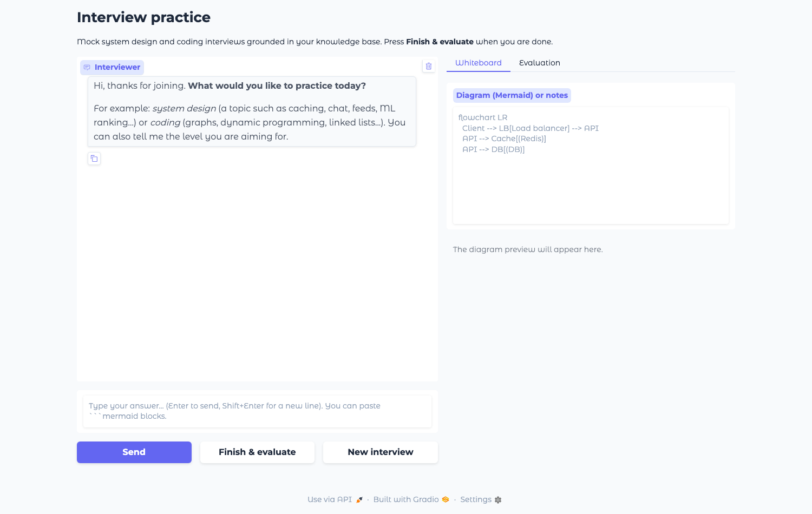
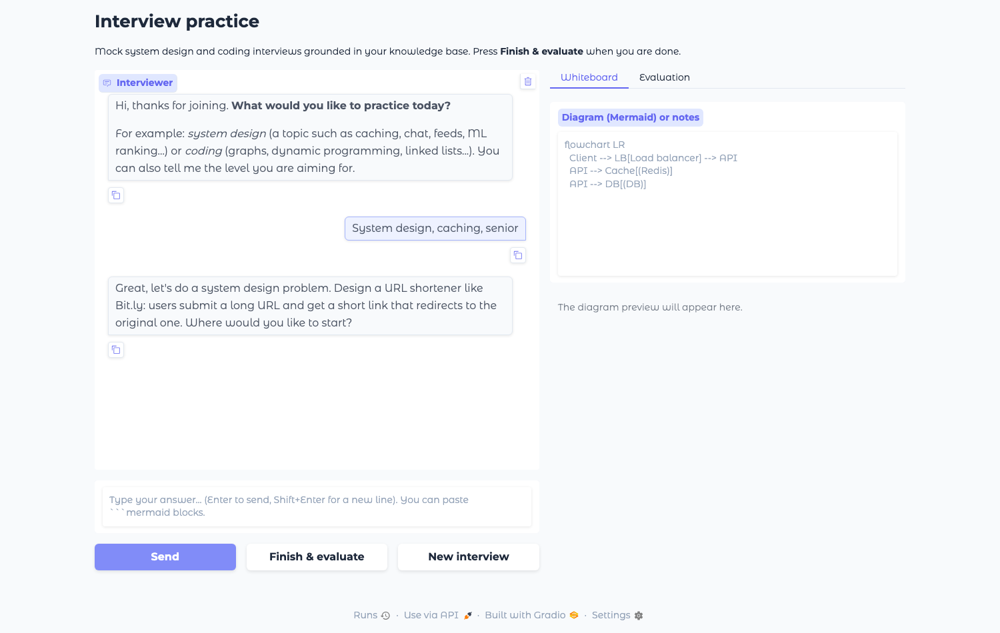
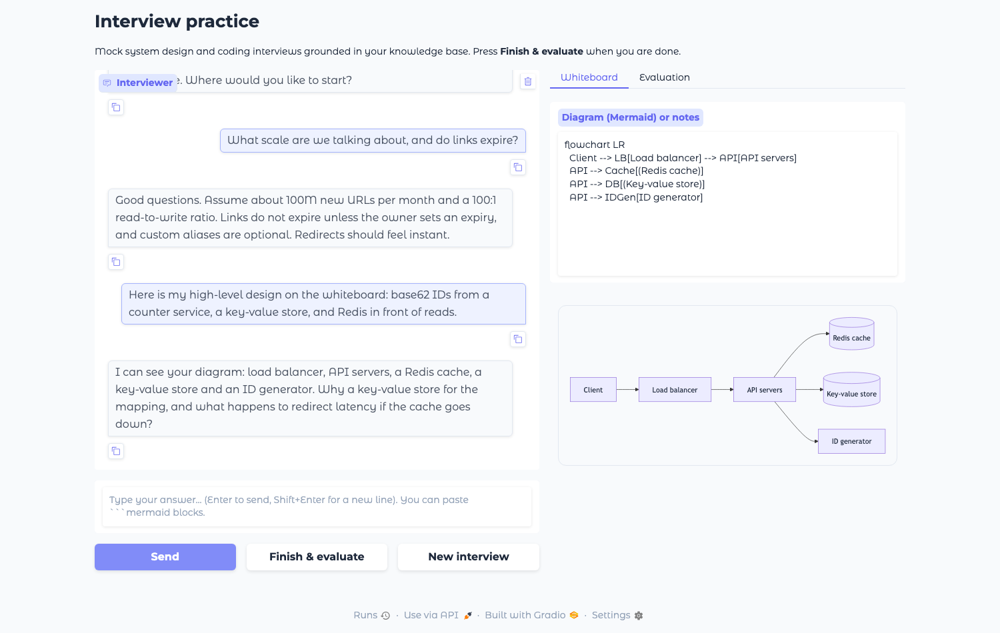
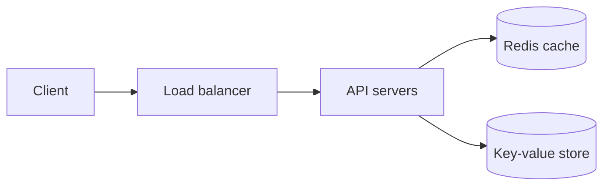
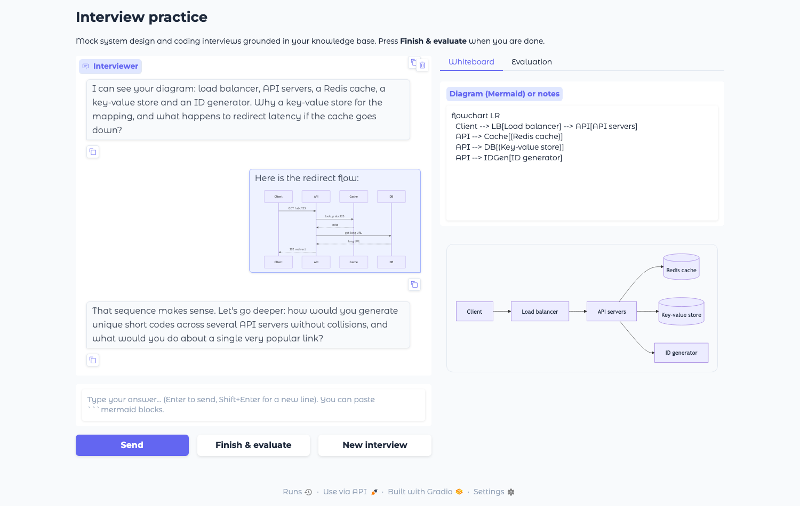
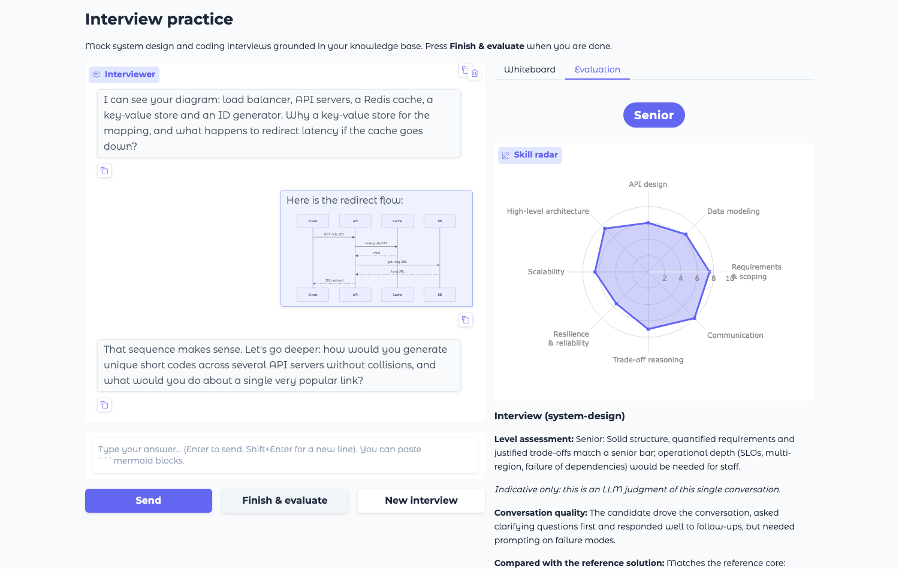
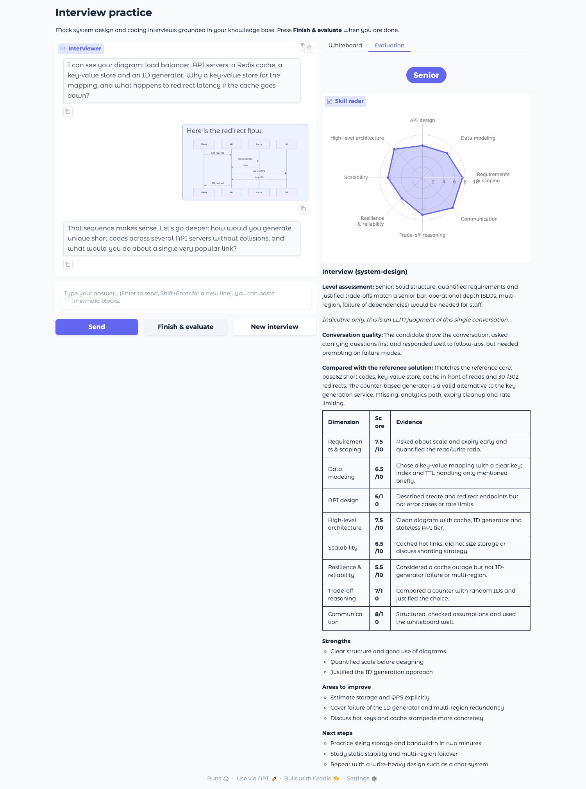

<p align="center">
  
</p>

# system-design-interviewer

A system that helps candidates prepare for system design interviews.

The idea is to build a structured knowledge base from books and online sources, and use it to practice: study concepts, review classic interview problems and rehearse answers.

## Structure

- `knowledge/concepts/`: one file per technical concept (caching, consistent hashing, quorum, etc.), with definition, how it works, trade-offs and the interviews it appears in.
- `knowledge/interviews/`: one file per interview problem (URL shortener, Ticketmaster, chat, etc.), with requirements, estimations, API, architecture, deep dives and links to its concepts.
- `knowledge/algorithms/`: one file per algorithm, data structure or technique (hash map, BFS, dynamic programming, etc.), with when to use it and complexity.
- `knowledge/coding-problems/`: one file per coding/algorithm interview problem, with approaches from brute force to optimal and links to its algorithms.
- `knowledge/levels/`: level expectations (junior to staff+) and probing questions for system design, coding and ML design interviews; used by the practice mode to calibrate the interviewer and the evaluator.
- `practice/`: practice mode (Gradio app with an interviewer agent and an evaluator agent that scores you with a radar chart and a level).
- `researcher/`: agent that looks for legally distributable PDFs of the source books.
- `docs/`: source documents (PDF) the knowledge is extracted from.
- `.claude/agents/`: Claude Code agents, including `knowledge-extractor`, which writes the content of a document or URL into `knowledge/`.
- `TODO.md`: list of candidate books to process.

## Quick start: practice mode

The practice mode is a Gradio app with two LLM agents: an **interviewer** that runs a mock system design or coding interview using this knowledge base, and an **evaluator** that scores the conversation.

1. **Create the environment** (Python 3.10+):
   ```bash
   cd practice
   python -m venv .venv && source .venv/bin/activate
   pip install -r requirements.txt
   ```
   Shortcut: `make practice` does steps 1-3 (creates the venv, copies `.env.example` to `.env` if missing, starts the app).
2. **Configure the LLM** (any OpenAI-compatible endpoint: OpenAI, OpenRouter, Ollama, vLLM, LM Studio). From the repo root:
   ```bash
   cp .env.example .env
   ```
   Then edit `.env`: `LLM_PROVIDER=openai`, `OPENAI_BASE_URL`, `OPENAI_API_KEY` and `OPENAI_MODEL`. The model must support tool calling. `TAVILY_API_KEY` is only needed by `researcher/`.
3. **Run it**:
   ```bash
   python app.py
   ```
   Open http://127.0.0.1:7860.
4. **Practice**:
   - The interviewer asks what you want to practice. Answer with a type, a topic and optionally your target level, e.g. *"system design, caching, senior"* or *"coding, graphs, mid-level"*.
   - It proposes a problem from the knowledge base. Ask clarifying questions and answer like in a real interview. Several valid solutions exist; it will probe trade-offs instead of correcting you.
   - Use the **Whiteboard** tab to draw with Mermaid (e.g. `flowchart LR` ...). Diagrams render live and are shared with the interviewer. You can also paste a ` ```mermaid ` block in the chat.
   - Press **Finish & evaluate** to get a radar chart, strengths, areas to improve, a comparison with the reference solution and a level estimate (junior, mid, senior, staff, staff+). The level is an indicative LLM judgment of one conversation.
   - **New interview** resets everything. Sessions are not stored.

More details in [`practice/README.md`](practice/README.md). To find and download legally distributable source PDFs, see [`researcher/README.md`](researcher/README.md).

## Practice mode: step-by-step guide

> The screenshots below were taken with a scripted demo model (the answers are canned examples) to show the interface. With your own model, the interviewer picks a real problem from `knowledge/` and the evaluation depends on your actual conversation.

### 1. Start
Open http://127.0.0.1:7860. The interviewer greets you and asks what you want to practice. The left side is the conversation; the right side has the **Whiteboard** and **Evaluation** tabs.



### 2. Say what you want to practice
Write a type, a topic and optionally a target level: *"system design, caching, senior"*, *"coding, graphs, mid-level"* or *"ML design, recommendations"*. The interviewer searches the knowledge base and presents one problem, briefly and without requirements, like a real interviewer.



### 3. Run the interview
Ask clarifying questions, state assumptions and walk through your design. The interviewer answers questions, probes trade-offs ("what happens if the cache goes down?") and accepts valid alternatives instead of steering you to one answer. Ask for a hint only if you are stuck.

### 4. Draw on the whiteboard
In the **Whiteboard** tab write [Mermaid](https://mermaid.js.org/) code; the diagram renders live below it. When you send your next message, the interviewer receives the diagram as text and comments on it.





### 5. Use diagrams in the chat too
Any ` ```mermaid ` block you send in the chat is rendered as a diagram (flowcharts, sequence diagrams, class and ER diagrams). A block that is incomplete or invalid stays as code.



### 6. Finish and read the evaluation
Press **Finish & evaluate**. The app switches to the **Evaluation** tab with:
- a level estimate (junior, mid, senior, staff or staff+) based on the quality of the whole conversation;
- a radar chart with 8 dimensions (for system design: requirements, data modeling, API, architecture, scalability, resilience, trade-offs, communication; for coding: understanding, algorithm, data structures, complexity, correctness, code quality, testing, communication);
- the conversation quality, a comparison with the reference solution (valid alternatives are credited), a table with the evidence for each score, strengths, areas to improve and next steps.



The level is an indicative LLM judgment of one conversation, not a hiring verdict. See the full report below.

<details><summary>Full evaluation report</summary>



</details>

### 7. Practice again
**New interview** clears the chat, the whiteboard and the evaluation. Nothing is saved between sessions. Tips: try each level target on the same problem to see how the follow-ups change, and use coding sessions to practice complexity analysis and edge cases out loud.

## Checking the knowledge base

Content in `knowledge/` is plain markdown with YAML frontmatter; interviews list their concepts in `concepts:` and coding problems list their algorithms in `algorithms:`. Those headers are the source of truth for the "Appears in" sections.

## How it is fed

Run the `knowledge-extractor` agent with a document path or a URL (and, optionally, a page or chapter range). The agent creates or merges concepts and interviews. Each interview lists its concepts in its header (`concepts:`), and that header is the source of truth for the interview-concept relationship.

## Sources

The problems and concepts come from the Hello Interview *problem breakdowns*, *Designing Data-Intensive Applications*, *System Design Interview* (Alex Xu, vol. 1 and 2) and *Grokking the System Design Interview*, plus coding-interview books for algorithms. The log of what has been processed is in `knowledge/_sources.md`.

All content is written in English.
